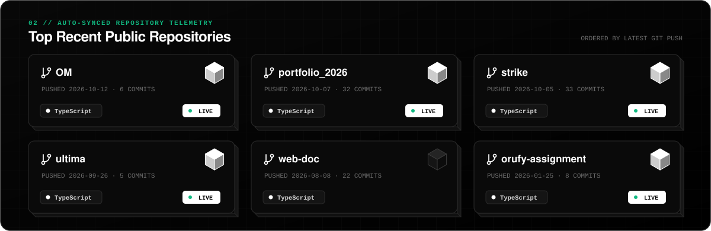

<a href="https://portfolio-2026-sooty-six.vercel.app">
  <picture>
    <source media="(prefers-color-scheme: dark)" srcset="./assets/hero_3d_dark.svg" />
    <source media="(prefers-color-scheme: light)" srcset="./assets/hero_3d_light.svg" />
    
  </picture>
</a>

  <a href="https://portfolio-2026-sooty-six.vercel.app"><strong>3D Portfolio</strong></a> &nbsp; // &nbsp;
  <a href="https://github.com/MohitKumawat4?tab=repositories"><strong>Repositories</strong></a> &nbsp; // &nbsp;
  <a href="https://ultima-five.vercel.app"><strong>Ultima</strong></a> &nbsp; // &nbsp;
  <a href="https://strike-lac.vercel.app"><strong>Strike</strong></a> &nbsp; // &nbsp;
  <a href="https://om-advertising.vercel.app"><strong>OM 3D</strong></a> &nbsp; // &nbsp;
  <a href="mailto:mohitkumawat23564@gmail.com"><strong>Contact</strong></a>

---

<picture>
  <source media="(prefers-color-scheme: dark)" srcset="./assets/projects_3d_dark.svg" />
  <source media="(prefers-color-scheme: light)" srcset="./assets/projects_3d_light.svg" />
  
</picture>

| Build | Architecture & Capabilities | Links |
| :--- | :--- | :--- |
| **Ultima** | Precision task orchestration engine with drag-and-drop workload balancing, role isolation, Resend notifications, and sub-second Supabase realtime state sync. | [Live App](https://ultima-five.vercel.app) · [Source](https://github.com/MohitKumawat4/ultima) |
| **Strike** | Real-time email intelligence platform streaming Gmail via Google Cloud Pub/Sub, scoring urgency with Gemini AI, and dispatching WhatsApp alerts. | [Live App](https://strike-lac.vercel.app) · [Source](https://github.com/MohitKumawat4/strike) |
| **OM Advertising** | Multi-chapter exterior Three.js storefront experience with scroll-choreographed camera landmarks and adaptive pixel rendering. | [Live App](https://om-advertising.vercel.app) · [Source](https://github.com/MohitKumawat4/OM) |
| **3D Portfolio** | Interactive WebGL portfolio engineered with custom GLSL fluid shaders, React Three Fiber physics, and kinetic scroll-stacked project cards. | [Live App](https://portfolio-2026-sooty-six.vercel.app) · [Source](https://github.com/MohitKumawat4/portfolio_2026) |

---

<a href="https://github.com/MohitKumawat4?tab=repositories">
  <picture>
    <source media="(prefers-color-scheme: dark)" srcset="./assets/repos_3d_dark.svg" />
    <source media="(prefers-color-scheme: light)" srcset="./assets/repos_3d_light.svg" />
    
  </picture>
</a>

---

<picture>
  <source media="(prefers-color-scheme: dark)" srcset="./assets/commits_3d_dark.svg" />
  <source media="(prefers-color-scheme: light)" srcset="./assets/commits_3d_light.svg" />
  
</picture>

---

### Engineering Stack & Background

- **Interfaces & Spatial Web**: TypeScript · JavaScript · Next.js 16 · React · Three.js · React Three Fiber · GLSL Shaders · Tailwind CSS · Framer Motion
- **Backend & AI Pipelines**: Node.js · Express.js · Google Gemini AI · Google Cloud Pub/Sub · WhatsApp Cloud API · REST APIs
- **Databases & Cloud**: Supabase (Realtime & RLS) · PostgreSQL · MongoDB · Vercel · GitHub Actions
- **Experience & Education**: Software Developer Intern at **LawDocs.in** (RBI compliance & loan origination systems) · B.Tech in Computer Science & Engineering (2022–2026)

  <strong>Open to select full-stack, frontend, and interactive 3D engineering roles.</strong> 
  <a href="mailto:mohitkumawat23564@gmail.com">mohitkumawat23564@gmail.com</a> &nbsp;·&nbsp;
  <a href="https://portfolio-2026-sooty-six.vercel.app">portfolio-2026-sooty-six.vercel.app</a>

